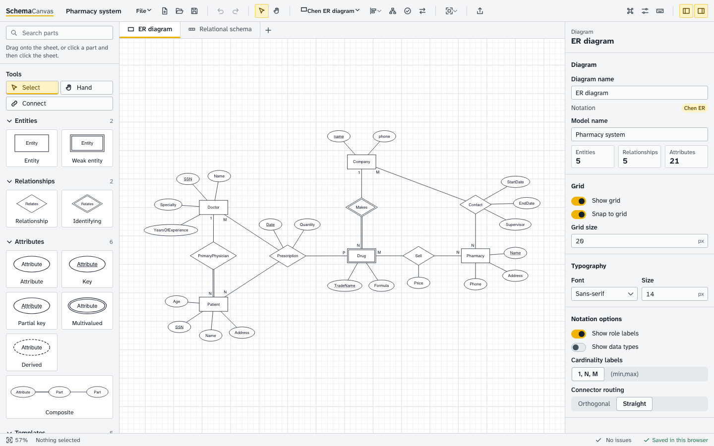
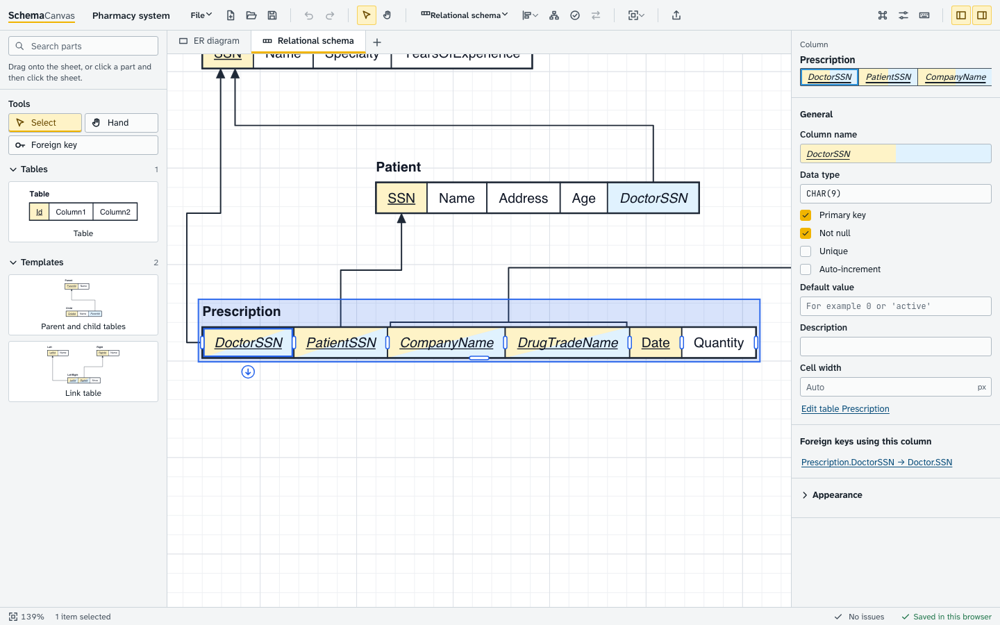

# SchemaCanvas

SchemaCanvas is a browser-based studio for database modelling. You draw Chen entity-relationship diagrams in academic notation (weak
entities, composite / multivalued / derived attributes, identifying relationships, total and partial participation, recursive and n-ary
relationships), convert them into a relational schema, and edit that schema as the horizontal single-row tables used in database courses:
one bordered cell per attribute, primary keys underlined, and foreign-key arrows that end on exactly the referenced cell, including
composite foreign keys. The same relational model can also be viewed as Crow's Foot or physical (vertical) tables, validated, and exported
as SQL DDL (PostgreSQL, SQLite, MySQL, generic) or DBML.

Everything runs in the browser. There is no backend, no account and no network call made by the application: projects live in your
browser (IndexedDB) and in `.schemacanvas.json` files you save yourself, and diagrams export to SVG, PNG and PDF. The domain model
(semantics) is kept separate from the diagram (presentation) and from geometry, so renaming or moving something never re-points a
foreign key. See [ARCHITECTURE.md](ARCHITECTURE.md).





More pictures and a walk-through of every step: [docs/USER-GUIDE.md](docs/USER-GUIDE.md).

## Status

**v0.1.0 public beta (release candidate), prepared for GitHub Pages.** Target: the public repository `xipuwang/schemacanvas`, site
`https://xipuwang.github.io/schemacanvas/`. Feature-complete for the first release described in the product specification, with documented limitations:
see [docs/KNOWN-LIMITATIONS.md](docs/KNOWN-LIMITATIONS.md). Verification results, release notes, build, GitHub Pages deployment and
release steps: [RELEASE.md](RELEASE.md). Nothing is deployed or published yet. All rights reserved: no licence is granted
(third-party components keep their own licences, see `public/THIRD-PARTY-NOTICES.txt`).

## Requirements

* Node.js 26 (developed and tested on 26.7) and npm. Other Node versions are not tested.
* For the browser tests and the screenshot script: Playwright's Chromium (`npx playwright install chromium`).
* A current Chromium-based browser to run the app (see [Browser support](#browser-support)).
* Optional, only for the PostgreSQL integration tier: a local PostgreSQL 14 installation (see [Tests](#tests)).

## Install and run

```bash
npm ci                 # install exactly what package-lock.json says
npm run dev            # Vite dev server on http://localhost:5173 (PORT=5180 npm run dev to change)
npm run build          # type-check (tsc --noEmit) + production build into dist/ (base /schemacanvas/, SC_BASE overrides)
npm run preview        # serve the built dist/ locally (vite preview, http://localhost:4173/schemacanvas/)
npm run serve:dist     # GitHub Pages emulation: scripts/serve-static.mjs dist 4173 /schemacanvas/ (no dependencies; see Deployment)
```

Other scripts: `npm run typecheck`, `npm run analyze` (bundle breakdown into `.tmp/bundle-analysis`), `npm run docs:shortcuts`,
`npm run docs:screenshots`.

## Tests

All commands are explained, with what each tier proves and how to read a failure, in [docs/TESTING.md](docs/TESTING.md). Summary:

| What | Command |
|---|---|
| Type-check | `npm run typecheck` |
| Unit + integration (Vitest, ~2.3k tests, about 20-60 s depending on load) | `npm test` (= `npx vitest run`); one area: `npx vitest run src/conversion` |
| Browser tests on the real app (Playwright) | `npm run test:e2e` (all, serial) or `npx playwright test e2e/export` |
| Acceptance (product specification "Definition of Done" as user scenarios, through the UI only) | `npx playwright test e2e/acceptance` |
| Visual dumps (SVG you can rasterise and look at) | `VISUAL=1 npx vitest run src/examples/visual.test.ts` then `node scripts/svg2png.mjs in.svg out.png` |
| Strict performance budgets | `PERF=1 npx vitest run src/integration/p6-scale.test.ts src/editor/dragPerf.test.ts`; `PERF=1` also tightens `e2e/editor2/perf.spec.ts` |
| Production smoke test of a built site, real input, three engines (after `npm run build`, with `npm run serve:dist` running) | `node scripts/smoke-prod.mjs all http://127.0.0.1:4173/schemacanvas/` (one engine: `chromium`, `firefox` or `webkit`) |
| Startup / hosting / ELK-worker measurements | `E2E_PORT=5223 PERF_MODE=dev npm run e2e:perf` (modes `dev`, `preview`, `subfolder`; the last two need `npm run build`) |
| Real Chromium clipping check of every example | `INTEGRATION_BROWSER=1 npx vitest run src/integration/p3-browser.test.ts` |
| Generated DDL on a real PostgreSQL | `INTEGRATION_PG=1 npx vitest run src/integration/p4-pg.test.ts` |

The Playwright config starts its own dev server on port 5199; set `E2E_PORT` to use another port (and to run several sessions side by
side). The PostgreSQL tier needs PostgreSQL 14 binaries (`initdb`, `pg_ctl`, `psql`) in `/opt/homebrew/opt/postgresql@14/bin` or in the
directory named by `PG_BIN`; it creates a throw-away cluster in `/tmp/sc-pg-integ` on port 55438 (unix socket only), always removes it,
and refuses to run if that port or folder is already in use. SQLite DDL is executed in the default unit run (`node:sqlite`, no extra
install). The MySQL tier (`INTEGRATION_MYSQL=1 npx vitest run src/integration/p4-mysql.test.ts`) executes the generated DDL in a running
MySQL 8.4 container (default name `schemacanvas-mysql`, override with `MYSQL_CONTAINER`) through `docker exec`, one throw-away database per case, e.g.
`docker run -d --rm --name schemacanvas-mysql -e MYSQL_ROOT_PASSWORD=sc -e MYSQL_DATABASE=sc mysql:8.4`.

## Project layout

Full map and the rules behind it: [ARCHITECTURE.md](ARCHITECTURE.md) section 3. Modules with a README are linked.

| Path | What |
|---|---|
| `src/model/` | The contract (`types.ts`), ids, builders, shared ER/relational semantics, **ops** (every semantic edit), versioned JSON in `io/` |
| `src/store/` | Zustand store: project, selection, tools, transactions, undo/redo; settings |
| `src/persistence/` | IndexedDB autosave, recent projects, project files |
| `src/scene/` | `buildScene()`: all derived geometry (text-fitted sizes, anchors, routed connectors) per notation (`chen/`, `horizontal/`, `vertical/`) |
| `src/render/` | Pure SVG components drawing a scene; the canvas and the exports use the same ones |
| `src/editor/` | Canvas interaction, command registry and shortcuts, keyboard layer, connect / FK / resize / route tools |
| `src/ui/` | Shell (toolbar, tabs, docks, status bar, palette), panels (library, properties, issues), dialogs, design system |
| `src/conversion/` | ER to relational conversion engine ([README](src/conversion/README.md)) |
| `src/validation/` | Database-aware validation rules ([README](src/validation/README.md)) |
| `src/layout/` | ELK auto-layout in a Web Worker, Chen layout, align / distribute / snap ([README](src/layout/README.md)) |
| `src/export/` | SVG, PNG, PDF, project JSON ([README](src/export/README.md)) |
| `src/sql/` | DDL generation, DDL import parser, DBML ([README](src/sql/README.md)) |
| `src/examples/` | Seven examples and the library templates ([README](src/examples/README.md)) |
| `src/i18n/` | English and Chinese catalogues ([README](src/i18n/README.md)) |
| `src/integration/` | Cross-module pipeline tests ([README](src/integration/README.md)) |
| `e2e/` | Playwright specs, one folder per area; `e2e/acceptance` and `e2e/perf` |
| `scripts/` | `serve-static.mjs`, `smoke-prod.mjs` (real-input smoke test of a served build), `bundle-size.mjs`, `svg2png.mjs`, `gen-shortcuts.mjs`, `docs-screenshots.mjs`, release: `gen-notices.mjs` (`npm run notices`), `check-dist.mjs` (`npm run check:dist`); build plugin: `vite-i18n-split.ts` + `i18n-collect.ts` (lazy Chinese catalogue) |
| `docs/` | [User guide](docs/USER-GUIDE.md), [testing](docs/TESTING.md), [shortcuts](docs/SHORTCUTS.md) (generated), [design language](docs/DESIGN.md), [performance and hosting](docs/PERFORMANCE.md) |

## How the app keeps and exports your work

* **Autosave.** After every change (and every viewport move) the app waits 500 ms and writes the whole project to IndexedDB (database
  `schemacanvas`). When the page is being hidden or closed, a synchronous copy of any not-yet-confirmed state is also written to
  `localStorage` (a write-ahead journal, skipped above about 3 million characters) and reconciled into IndexedDB on the next start, so the
  last edits survive a quick reload. Reloading the page reopens the last project and the sheet you were on. The status bar shows "Saved in this browser", "Saving", or an
  explanation when the browser blocks storage (private windows, blocked site data); then the app keeps working but warns before you
  leave with unsaved changes.
* **Replacing a project is safe.** New, Open, Open example and Recent first snapshot the current project into **Recent projects** and
  show a "Reopen previous" action.
* **Files.** *Save* downloads `<project name>.schemacanvas.json` (versioned, plain JSON; a newer file version than the app knows is
  refused with an explanation). *Open* picks a file; you can also drop one onto the window. Everything the editor knows round-trips:
  semantics, notation options, positions, sizes, column widths, routes and bends.
* **Export** (`Ctrl/Cmd+Shift+E`): SVG (vector, text stays text), PNG (scale up to a pixel cap), PDF (vector, A4/Letter/content-sized),
  the project file, and SQL / DBML text for relational models. Exports draw the same scene as the canvas, sized to the painted bounds
  plus padding, so nothing is clipped. Import (File menu): SQL `CREATE TABLE` statements, DBML, or a project file.
* **Keyboard.** Every command has a menu entry and appears in the command palette (`Ctrl/Cmd+K`); the shortcuts table is generated from
  the command registry: [docs/SHORTCUTS.md](docs/SHORTCUTS.md) (in the app: `?` or `F1`). Refresh it with `npm run docs:shortcuts`
  (`node scripts/gen-shortcuts.mjs --check` fails when the file is out of date).

## Deployment

**Target: GitHub Pages**, project site `https://xipuwang.github.io/schemacanvas/`, from the public repository `xipuwang/schemacanvas`
(source and site in one repository). The one-time setup, the release steps, the live-site checks and the rollback procedure are in
[RELEASE.md](RELEASE.md). Nothing has been created, pushed or published yet.

The production build is a static site: no server code, no SPA fallback (there is no router). Asset URLs are built against a base path:

| Setting | Effect |
|---|---|
| default | `base: '/schemacanvas/'` (`BUILD_BASE` in `vite.config.ts`), for the project site above |
| `SC_BASE=/` | domain root (for example a custom domain): `SC_BASE=/ npm run build` |
| `SC_BASE=./` | relative URLs, any folder |

The dev server and the Playwright suites always run at `/`. `vite preview` and `npm run serve:dist` use the build base, so the local
URL is `http://localhost:4173/schemacanvas/`.

```bash
npm ci
npm run release:build  # regenerates THIRD-PARTY-NOTICES.txt, type-checks, builds dist/, then runs the publish gate
```

`npm run release:build` runs `npm run notices`, `npm run build`, and `npm run check:dist`. The last step, `scripts/check-dist.mjs`, fails if `dist/` contains:
- a source map;
- an absolute local path or a `localhost` URL;
- a dev-only package or a secret-like token;
- a root-absolute asset URL that is not under the base;
- a host configuration file (`_headers`, `_redirects`, `wrangler.toml`).

It also fails if the meta CSP is missing, does not pin exactly the inline scripts, or contains a directive that only works as a header
(`frame-ancestors`, `report-uri`, `sandbox`); if `404.html` is missing or does not link to the base; or if `THIRD-PARTY-NOTICES.txt` is missing.
Publish only a `dist/` that passed it. `dist/THIRD-PARTY-NOTICES.txt` carries the licence texts the bundled components require (MIT, OFL-1.1
fonts, EPL-2.0 elkjs with its source pointer, Apache-2.0 DOMPurify).

### Security headers on GitHub Pages

GitHub Pages cannot send custom response headers. The protections that can be expressed in HTML are therefore built into `index.html`
at build time, and the rest is listed as impossible on this host.

| Protection | On GitHub Pages | How |
|---|---|---|
| Content-Security-Policy | **enforced** | `<meta http-equiv="Content-Security-Policy">` injected by `scripts/vite-csp.ts`; the hashes of the inline scripts are computed at build time. Policy: `default-src 'none'`, `script-src 'self' 'sha256-…'`, `style-src 'self' 'unsafe-inline'`, `img-src 'self' data: blob:`, `font-src 'self' data:`, `worker-src 'self' blob:`, `connect-src 'self' data: blob:`, `base-uri 'none'`, `form-action 'none'`, `object-src 'none'` |
| Referrer-Policy | **enforced** | `<meta name="referrer" content="no-referrer">` |
| X-Content-Type-Options: nosniff | **depends on GitHub** | Whatever GitHub Pages sends. Check it on the live site (see RELEASE.md); it cannot be set by the app |
| `frame-ancestors` / X-Frame-Options (clickjacking) | **impossible** | `frame-ancestors` is ignored in a meta CSP, and the app cannot set X-Frame-Options on GitHub Pages; GitHub Pages is not known to send one (check on the live site) |
| Permissions-Policy | **impossible** | header only |
| Cross-Origin-Opener-Policy | **impossible** | header only |
| Cache-Control | **impossible to tune** | GitHub Pages sends its own caching (about 10 minutes) for every file |
| HSTS | **by github.io** | the domain's own setting |
| Unknown paths | **404** | `404.html` is served with status 404 |

Hosts that send headers (for example a server you control) can add `frame-ancestors 'none'`, `Permissions-Policy`, COOP and the
long-lived caching of `/assets/*`. The app works without them.

**Server requirements.**
- **Trailing slash.** The default build uses absolute asset URLs under the base (`/schemacanvas/assets/...`), so the address works
  with or without the slash, and GitHub Pages redirects `/schemacanvas` to `/schemacanvas/` anyway. Only a relative build
  (`SC_BASE=./`) needs its folder URL to end with `/`, because its asset URLs would otherwise resolve one level up.
- **Unknown paths should return 404.** There is no client-side router, so an SPA fallback to `index.html` is harmless but unnecessary.
- **No special headers are needed.** That includes COOP/COEP; there is no WebAssembly and nothing cross-origin.

Other static hosts: build with `SC_BASE` set to the path the site is served from, then upload the contents of `dist/`. Verified for the
base `/schemacanvas/` by `scripts/serve-static.mjs dist 4173 /schemacanvas/` (a server that 404s everything outside that prefix, and
serves `404.html` for misses) with the production smoke test (`scripts/smoke-prod.mjs`) in Chromium, Firefox and WebKit, and the
browser tests in `e2e/perf` (`PERF_MODE=subfolder`).

* **Any static server:** `npx serve dist`, `python3 -m http.server -d dist`, nginx / Apache / Caddy with the folder as the document root.
  The server must send correct MIME types for `.js` (`text/javascript`), `.css`, `.svg`, `.json` and `.woff2`.
* **Compression and caching (recommended on hosts you control):** serve `assets/*` with gzip or brotli and `Cache-Control: public, max-age=31536000, immutable`
  (file names are content-hashed); serve `index.html` with `Cache-Control: no-cache`.
* **Offline use:** the app needs nothing from the network after its files are loaded: fonts are bundled, there are no CDN or API calls and no
  telemetry. There is no service worker, so a cold start still needs the host (or a local copy: `npm run preview`, or open `dist/` through
  any local static server). The browser's own HTTP cache is what keeps it usable after the first load; it is not an installable offline app.
  (`file://` is not supported: the ELK worker and module scripts need an HTTP origin.)

## Browser support

Developed in Chromium, where the full browser suite runs. The acceptance suite (the Definition of Done scenarios: Chen authoring, conversion,
horizontal schema editing, save/reopen, exports) also passes in Playwright's Firefox and WebKit (`npm run e2e:cross`, after
`npx playwright install firefox webkit`). Other browser test folders and real desktop Safari were not run. The app uses standard web APIs
(IndexedDB, Web Workers, SVG, Blob downloads, `<input type=file>`, optional async clipboard for "copy as PNG"). The layout is responsive
(three columns from 1100 px, drawers below, bottom sheet below 700 px) but pointer-heavy editing is designed for a mouse or trackpad.
Light and dark themes follow the system setting unless chosen in Settings; reduced-motion is respected.

## Data privacy

Everything stays in your browser. The application makes no network requests of its own and has no analytics. Stored locally:

| Where | Key | Contents |
|---|---|---|
| IndexedDB database `schemacanvas`, object store `kv` | `autosave:current` | the current project (project file envelope as JSON text) |
| | `project:<id>`, `meta:<id>` | one record per project that was replaced or saved (the "Recent projects" list) and its name / dates |
| | `autosave:backup:<savedAt>` | only after the crash screen's "Start with an empty project": up to 3 copies of the stored project |
| `localStorage` | `schemacanvas:settings:v1` | theme, language, which panels are shown |
| | `schemacanvas:shell:v1` | dock sizes, live-validation flag |
| | `schemacanvas:welcome:v1` | "Don't show the welcome card again" |
| | `schemacanvas:library:v1` | which library sections are collapsed |
| | `schemacanvas:viewstate:v1` | per project id: the active sheet and open bottom dock (up to 40 projects) |
| | `schemacanvas:journal:v1` | transient write-ahead copy of the project while a save is unconfirmed (removed once IndexedDB has it) |

Settings > **Clear local data** replaces the open project with an empty one and removes the IndexedDB records, the journal and the
view state. It keeps the preference keys (theme, language, panels) and reports an error if the browser refuses to clear.
Clearing site data for the origin removes all of it. If the app ever crashes, the crash screen stops all saving for that page, so the last
good autosave is not overwritten. It also offers to download the stored project or to start with an empty project. Project files are written only when you choose Save or Export. Two copies of the app
on different origins (for example `localhost:5173` and a deployed URL) do not share projects; use project files to move work between them.

## Troubleshooting

* **"Not saved" / a warning about storage.** The browser is blocking IndexedDB (private window, blocked site data, full disk). Save a
  project file regularly; the app still works.
* **A project file will not open.** The error names the problem (not JSON, not a SchemaCanvas file, newer version, invalid structure with
  the path of the bad field). Files written by newer versions are refused rather than guessed at.
* **PDF with a message about an image.** The diagram contains characters outside the PDF standard fonts (for example Chinese labels), so the
  page is embedded as an image: still correct to look at, but the text is not selectable. SVG and PNG are unaffected.
* **Auto-layout is slow on a very large diagram.** ELK runs in a worker so the page stays responsive; press `Esc` to cancel it.
* **A blank page from `file://`.** Serve `dist/` over HTTP (`npm run preview`).
* **`npm run dev` says the port is in use.** Vite picks the next free port and prints it; or set `PORT`.
* **Browser tests fail to start.** Install the browser once: `npx playwright install chromium`. Tests are sensitive to machine load; see
  the load-sensitivity notes in [docs/TESTING.md](docs/TESTING.md) before chasing a failure.

## Contributing notes

Read [ARCHITECTURE.md](ARCHITECTURE.md) first: semantics never contain geometry; every semantic edit is an op inside `store.commit`; all
derived geometry comes from `buildScene`; every user-visible string needs real English and Chinese text; chrome colours come from
`src/ui/theme/tokens.css`. A change is done when it has a regression test and the relevant suites in [docs/TESTING.md](docs/TESTING.md) pass.
