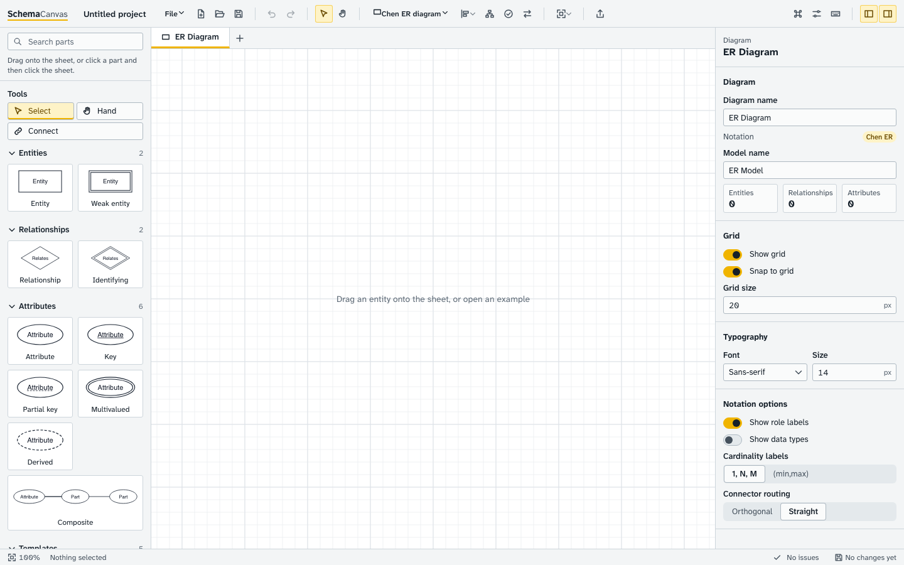
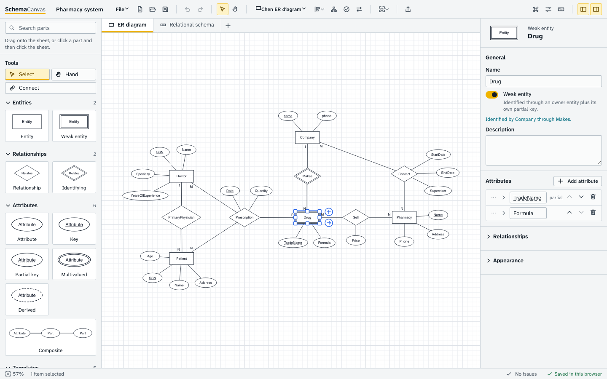
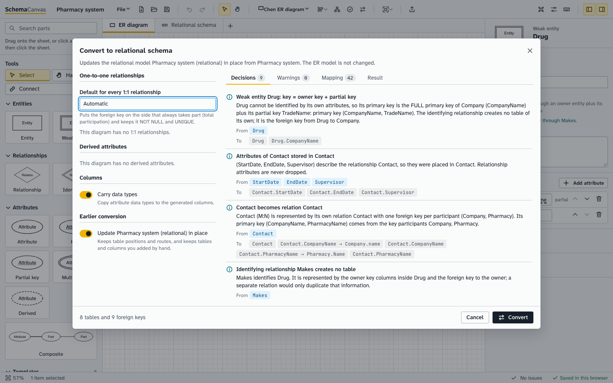
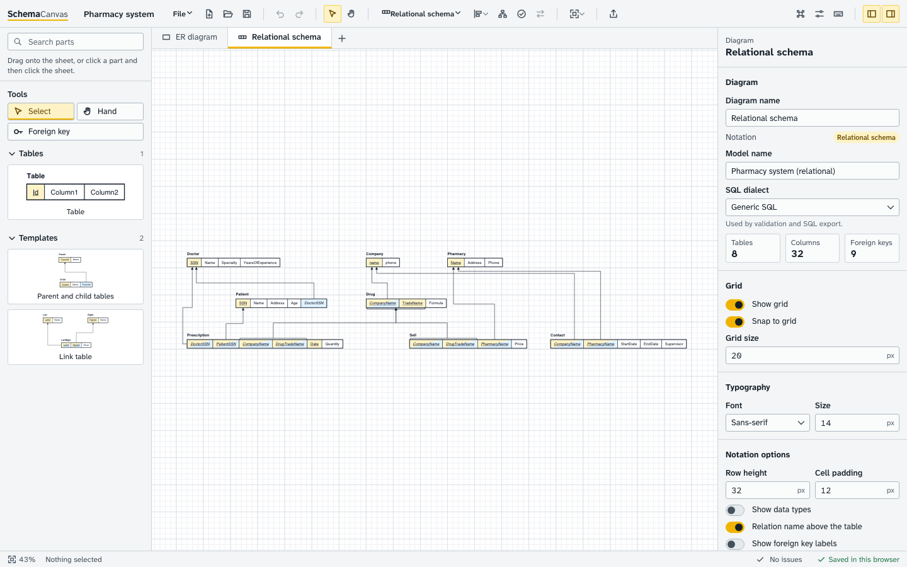
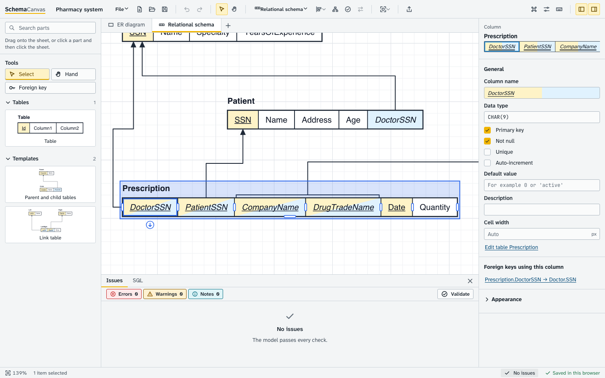
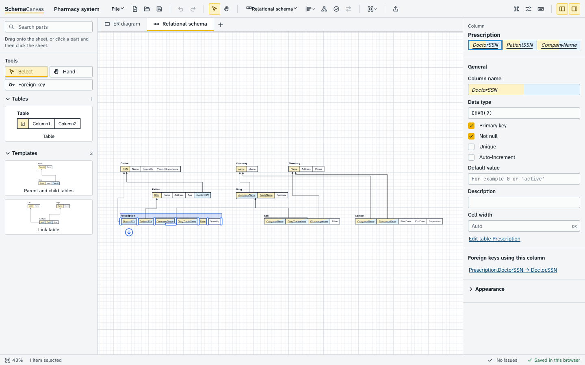
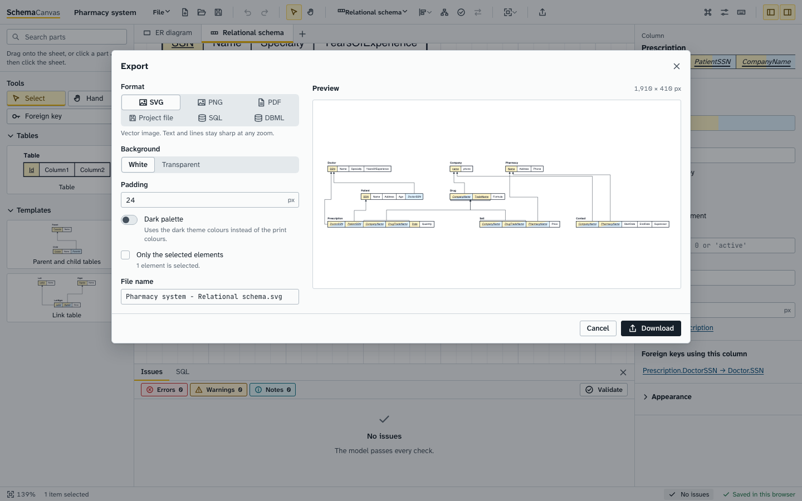

# SchemaCanvas user guide

This guide follows the ten steps of the "definition of done": from an empty sheet to an exported, validated relational schema. Every
picture was taken from the running application with `npm run docs:screenshots` (the Pharmacy example). The list of keyboard shortcuts is in
[SHORTCUTS.md](SHORTCUTS.md); setup and hosting are in the [README](../README.md).

Contents: [1 Open](#1-open-schemacanvas) - [2 Chen diagram](#2-create-a-chen-er-diagram) - [3 Entities, keys, relationships](#3-strong-and-weak-entities-keys-attributes-relationships) -
[4 Convert](#4-convert-the-er-diagram-to-a-relational-schema) - [5 Horizontal schema](#5-view-and-edit-the-horizontal-schema) - [6 Keys and references](#6-inspect-primary-keys-and-foreign-keys) -
[7 Validate](#7-validate-the-model) - [8 Move tables](#8-move-tables-without-breaking-anything) - [9 Save](#9-save-and-reopen-your-work) - [10 Export](#10-export-for-an-assignment-or-report) -
[Notation reference](#notation-reference) - [Conversion rules](#conversion-rules-with-the-pharmacy-example) - [Other views and SQL](#other-views-sql-and-dbml)

## 1. Open SchemaCanvas

Open the app in a Chromium-based browser (see the README for how to run it locally or host it). You see three areas: the **parts library** on
the left, the **sheet** in the middle, and the **properties** panel on the right; the toolbar is on top and the status bar (zoom, selection,
issue counts, "Saved in this browser") at the bottom.

On a narrow window the side panels become drawers (toolbar buttons or `Ctrl/Cmd+B`, `Ctrl/Cmd+I`). To explore first, use **File, Open
example** (or the command palette, `Ctrl/Cmd+K`, type "examples"): there are seven, among them the four small cases and the full
Pharmacy system. Each example opens with both its ER diagram and its relational schema as two sheet tabs.

## 2. Create a Chen ER diagram

A new project starts with an empty **Chen ER** sheet. Three ways to add things:

* **Drag a part** from the library onto the sheet, or click a part and then click the sheet.
* **Keyboard:** `E` new entity at the centre of the view, `Shift+R` new relationship, `A` add an attribute to the selected shape.
* **Connect tool** (`C`): press on an entity and drag to another entity; SchemaCanvas creates a relationship between them with both
  participation lines. Drag from an entity to a relationship (or back) to add a participant. Dragging the same entity onto the same
  relationship again makes a recursive participant; dragging from an entity back onto itself makes a recursive relationship.

Double-click a name (or select it and press `F2`) to rename it in place. Selecting an entity shows small ports: the **+** port adds an attribute
(click for a simple one, hold for a menu of key / partial key / multivalued / derived / composite).

Everything stays editable: select any shape and its form appears in the properties panel.

## 3. Strong and weak entities, keys, attributes, relationships

Select an entity and use the properties panel (shown below for the weak entity **Drug**).

* **Weak entity** switch: draws the double rectangle. A weak entity needs an *identifying relationship* to its owner (a double diamond, set with
  the "Identifying" switch on the relationship) and a **partial key** attribute (dashed underline). The panel tells you which owner
  identifies it ("Identified by Company through Makes").
* **Attributes** are listed in the panel: rename, reorder, remove, and mark each as key, partial key, multivalued, derived, optional,
  with a data type. Composite attributes hold sub-attributes (children can nest). Relationships can have attributes too.
* **Relationship forms:** for each participant set the **cardinality** (One or Many) and the **participation** (Partial or Total), and an
  optional **role** name (essential for recursive relationships). The panel states the meaning in words ("Each Company is related through
  Makes to any number of Drugs"). Ternary and n-ary relationships have three or more participants.

Cardinality is written the classic Chen way, "look across": the `N` next to **Drug** means one Company has many Drugs, and a Drug belongs to at most
one Company; the foreign key goes to the N side. Participation is read at the near side: a **double line** means every instance of that entity
takes part. With nothing selected, the properties panel shows the sheet's **notation options**: cardinalities as `1, N, M` or as `(min,max)` pairs,
data types, role labels, straight or orthogonal connectors (the same options are in the Diagram options dialog).

## 4. Convert the ER diagram to a relational schema

With an ER sheet active, press the **Convert** toolbar button (arrows icon, "Convert to relational schema").

The dialog previews the result before anything changes:

* **Options** (left): the default for every 1:1 relationship (Automatic, Merge into one table, or a separate table) with per-relationship
  choices; which **derived attributes** to store anyway; whether to carry data types; and, when this ER model was converted before, whether
  to **update the earlier schema in place** (keeps table positions, routes, and tables or columns you added by hand).
* **Decisions** (right, first tab): one plain-language explanation for each major decision, with the ER source and what it produced.
* **Warnings:** ambiguities and constraints that ordinary foreign keys cannot enforce (for example "total participation on the 1 side"). Nothing is
  dropped silently.
* **Mapping:** the traceable list of every ER element and the schema elements it became. **Result:** the generated tables.

Press **Convert**: the new relational model and a horizontal schema diagram appear as a new tab, laid out automatically, in one undoable
step. The ER model is never changed. The Pharmacy example in the screenshot already carries its converted schema, so the dialog offers to update it in place.

## 5. View and edit the horizontal schema

The relational sheet draws each relation as the single-row table used in database courses: the name above, one bordered cell per attribute.

Zoomed in (select a table and press `Shift+2` to fit the selection), with a column selected and its form open:

* **Edit in place:** double-click a name to rename a relation or a column. The library has a **Table** part, and the *Parent and child tables*
  and *Link table* templates.
* **Columns:** the panel offers name, data type, primary key, not null, unique, auto-increment, default value, description and cell width.
  Use **Add column** in the properties panel of the table, reorder columns there, drag a column border to
  resize its cell (double-click resets), drag the bottom edge for the row height. The round arrow button below a selected cell is the
  foreign-key port: drag from it to start a foreign key.
* **Foreign keys:** pick the **Foreign key tool** (`F`) and drag from a column cell to the referenced table. Shift-click builds a composite
  source. On release a small popover shows `Patient.DoctorSSN -> Doctor.SSN` and the column mapping; nothing exists until you press Create.
  Targets that are not a key, have the wrong number of columns, or would duplicate an existing foreign key are refused with the reason.
* **Keyboard:** `Enter` on a selected table enters *cell mode* (arrow keys move between columns, `Space` marks a column, `F2` renames),
  `Shift+F` creates a foreign key from the selected column. See [SHORTCUTS.md](SHORTCUTS.md).

## 6. Inspect primary keys and foreign keys

In the horizontal notation (see the [reference](#horizontal-relational-schema-marks)) a primary-key cell is **underlined** and tinted, a
foreign-key cell is *italic* and tinted differently, a cell that is both is underlined and italic with a two-tone fill, and a plain
attribute is plain. These differences survive grayscale printing.

Select any column: the panel lists **Foreign keys using this column** (for example `Prescription.DoctorSSN -> Doctor.SSN`; click to select that
constraint). Select a connector to see and edit its constraint: the referenced table and columns, the stated cardinality, referential
actions (such as on delete), an optional label. A **composite** foreign key is one constraint however many arrows it uses: in the Pharmacy example,
`Prescription.(CompanyName, DrugTradeName) -> Drug.(CompanyName, TradeName)` is drawn with a bracket over the two source cells joined by one
arrow to the two key cells. The arrow always ends on the exact referenced cell, and the end is computed from the column ids, never from
pixels, so it cannot drift to an unrelated field. The sheet's notation options switch composite foreign keys between *bracket* and *branches* (one
arrow per column pair).

You can adjust a connector: drag its bend handles, drag a midpoint handle to add a bend, slide an end along the allowed side of its cell, or
`Reset route` (`R`) to let the router choose again. None of this changes the constraint.

## 7. Validate the model

Press **Validate** (`F8`) or click the issue counts in the status bar. Validation also re-runs shortly after edits.

Each finding has a title, an explanation, the affected object, a severity (**error** for a definite structural problem, **warning**, **note** for design
advice) and a suggested resolution; clicking one selects and shows the object on the canvas. Examples: a relation without a primary key, a foreign key to a missing
table or column, an incomplete composite reference, duplicate attribute names, a weak entity without an identifying owner or partial key,
conflicting cardinality, and issues that would appear in the generated SQL. Unconventional but valid designs are not reported as errors. The
**SQL** tab next to Issues shows the generated DDL for the active relational model.

## 8. Move tables without breaking anything

Drag tables freely (snap to grid unless you hold `Alt`; smart guides help aligning). Select several shapes (click with `Shift`, drag a
marquee, `Ctrl/Cmd+A`) to move, align and distribute them from the **Arrange** menu, or run **Auto-layout** (`Ctrl/Cmd+Shift+L`, ELK in the
background; `Esc` cancels). Manual positions are kept; locked tables stay put during auto-layout. Foreign-key arrows are attached to column ids:
they follow the tables, re-route around other tables, and always end at the same referenced cell. Every step has **Undo/Redo**
(`Ctrl/Cmd+Z`, `Ctrl/Cmd+Shift+Z`).

## 9. Save and reopen your work

* **Autosave:** the app writes to your browser about half a second after each change; reload the page and your project is back. Look for
  "Saved in this browser" in the status bar.
* **Save to a file:** `Ctrl/Cmd+S` downloads `<project name>.schemacanvas.json`. Open it again with **Open** (`Ctrl/Cmd+O`) or by dropping it on the
  window. Names, keys, constraints, cardinalities, positions, sizes, column widths and routes all come back.
* **Recent projects:** starting something new, opening a file or an example first keeps the previous project under **File, Recent projects**; a
  toast offers **Reopen previous** for a few seconds.
* **Rename the project** by clicking its name in the toolbar.

## 10. Export for an assignment or report

Press **Export** (`Ctrl/Cmd+Shift+E`).

* **SVG:** vector, text stays text and lines stay sharp at any zoom.
* **PNG:** raster at 2x by default (you can change the scale; very large sizes are reduced with a note).
* **PDF:** vector; content-sized, A4 or Letter, auto orientation. If a label contains characters the standard PDF fonts cannot show
  (for example Chinese), the page is embedded as an image and the dialog says so.
* **Project file**, and **SQL** (PostgreSQL, SQLite, MySQL, generic) and **DBML** for relational models; from an ER sheet they use the converted model,
  and the dialog asks you to convert first if there is none.
* Options: white or transparent background, padding, light colours (default) or the dark palette, and "only the selected elements".
  The exported area is the painted bounds plus padding, so nothing is clipped; the preview shows exactly what you get.

## Notation reference

### Chen ER symbols

| Symbol | Meaning |
|---|---|
| Single rectangle | **Strong entity** |
| Double rectangle | **Weak entity**: identified only through an owner entity plus its own partial key |
| Rectangle around a diamond | **Associative entity**: a relationship treated as an entity |
| Single ellipse | **Simple attribute** |
| Ellipse, name underlined | **Key attribute** (identifies an instance) |
| Ellipse, name with dashed underline | **Partial key** of a weak entity |
| Double ellipse | **Multivalued attribute** (several values per instance) |
| Dashed ellipse | **Derived attribute** (computed from others, not stored) |
| Ellipse with child ellipses | **Composite attribute** (for example Address with Street, City, Zip) |
| Diamond | **Relationship**; ellipses attached to it are relationship attributes |
| Double diamond | **Identifying relationship** (weak entity to its owner) |
| Single line | **Partial participation**: some instances may not take part |
| Double line | **Total participation**: every instance takes part |
| `1`, `N`, `M` beside an entity | **Cardinality**, read "across" the relationship (one Company has many Drugs: `N` beside Drug) |
| Text on a line | **Role** name |
| Two lines from one entity to one diamond | **Recursive relationship** (use roles to tell them apart) |

### Horizontal relational-schema marks

| Mark | Meaning |
|---|---|
| Relation name above the row | The relation (table); one row, one bordered cell per attribute |
| Underlined cell, yellow tint | **Primary key** attribute; a composite key underlines every key cell |
| *Italic* cell, blue tint | **Foreign key** attribute |
| Underlined *and* italic, two-tone | Attribute that is both primary and foreign key |
| Plain cell | Regular attribute |
| Arrow | Foreign key: leaves from the referencing cell(s), the arrowhead touches the **referenced** cell; direction is referencing to referenced |
| One bracket over several cells + one arrow | **Composite foreign key** (one constraint). "Branches" style draws one arrow per column pair |
| Small text under the name | Optional data types, when "Show data types" is on |

### Crow's Foot symbols

Create one with the **+** button next to the sheet tabs, "View of" a relational model (a Crow's Foot ERD or a Physical model sheet), and choose
vertical tables (name, then one row per column with `PK` / `FK` badges, types, `NN` and `UQ`) or horizontal tables (the *Tables* option in the
properties panel, or the orientation control in the toolbar's diagram-type menu).

| End symbol | Meaning |
|---|---|
| Two bars `\|\|` | **Exactly one** (mandatory, single) |
| Circle and bar `o\|` | **Zero or one** (optional, single) |
| Crow's foot with bar `\|{` | **One or many** (at least one) |
| Crow's foot with circle `o{` | **Zero or many** |

The symbols are derived from the foreign key's cardinality and nullability: the referenced (parent) end shows `\|\|` when every child must have
a parent, else `o\|`; the referencing (child) end shows the foot when many rows may reference one parent. The Physical model additionally shows
auto-increment, defaults, constraints and indexes.

## Conversion rules with the Pharmacy example

The Pharmacy example has five entities (Doctor, Patient, Pharmacy, Company and the weak entity Drug) and five relationships. Its result is 8 tables
and 9 foreign keys. Underscores mark primary keys.

| Rule | What it does | Pharmacy result |
|---|---|---|
| **Strong entity** | One relation with its stored atomic attributes; the key attributes become the primary key | `Doctor(_SSN_, Name, Specialty, YearsOfExperience)`, `Pharmacy(_Name_, Address, Phone)`, `Company(_name_, phone)` |
| **Composite attribute** | Flattened into its atomic parts (the parent is not a column) | (Student example: Name and Address become `First, Middle, Last, Street, City, ZipCode`) |
| **Multivalued attribute** | A separate relation; the owner's key is a foreign key; the primary key is owner key plus the value | (Student example: `Student_ProgrammingLanguages(_SID_, _ProgrammingLanguages_)` and `Student_Preference(...)`) |
| **Derived attribute** | Not stored. The dialog says it was omitted and why; you can tick it to store it as an ordinary column | Student's `Age` is omitted unless you choose to store it. (Pharmacy's `Age` on Patient is an ordinary attribute) |
| **Weak entity** | Primary key = owner's full primary key + the partial key; a foreign key to the owner. The identifying relationship gets **no table** | `Drug(_CompanyName_, _TradeName_, Formula)`, FK `Drug.CompanyName -> Company.name`; no table for *Makes* |
| **1:N relationship** | Foreign key = the primary key of the **1** side, placed in the **N** side; relationship attributes go with it | `Patient.DoctorSSN -> Doctor.SSN` (*PrimaryPhysician*) |
| **1:1 relationship** | By default the foreign key goes on the side that always takes part (total participation), `NOT NULL` and `UNIQUE`; alternatives are *merge into one table* and *separate table*. Ambiguous cases raise a warning, and what ordinary foreign keys cannot enforce is explained | (no 1:1 in this example; the dialog shows the choices when there is one) |
| **M:N relationship** | Its own relation with a foreign key to each participant; primary key from the participants' keys; relationship attributes kept | `Contact(_CompanyName_, _PharmacyName_, StartDate, EndDate, Supervisor)` with FKs to Company and Pharmacy |
| **Ternary / n-ary relationship** | Its own relation with one foreign key per participant, role names preserved. The key comes from the ER semantics (the participants marked as key, plus key attributes of the relationship), not blindly from every foreign key; if it is not a valid key SchemaCanvas falls back to the first candidate key and warns | `Prescription(_DoctorSSN_, _PatientSSN_, _CompanyName_, _DrugTradeName_, _Date_, Quantity)`: FKs to Doctor, Patient, and the **composite** `(CompanyName, DrugTradeName) -> Drug(CompanyName, TradeName)` |
| **Recursive 1:N** | A self-referencing foreign key | (Employee example: `Employee(_Eid_, Name, ManagerEid)`, `ManagerEid -> Eid`) |
| **Recursive M:N** | A relation with two foreign keys to the same entity (names come from the roles) | (Course example: `PreReq(_Cid_, _Req_Cid_)`, both columns reference `Course.Cid`) |
| **Relationship attributes** | Never dropped: stored in the N-side relation, the relationship relation, or the weak relation | `Quantity`, `Date` in Prescription; `Price` in Sell; `StartDate`, `EndDate`, `Supervisor` in Contact |
| **Associative entity** | One relation: a foreign key per participant plus its own attributes | (library template) |

The Pharmacy *Sell* relationship is also M:N: `Sell(_CompanyName_, _DrugTradeName_, _PharmacyName_, Price)` with the composite foreign key to Drug.
The converter writes its reasoning into the **Decisions** tab and its caveats into **Warnings**, and records the mapping in **Mapping**.
Not supported: converting an arbitrary relational schema back into a Chen diagram (not claimed anywhere in the app).

## Other views, SQL and DBML

* **More views of a model:** the **+** button next to the sheet tabs offers a new empty model or a *View of* an existing model (including a
  Crow's Foot ERD or Physical model of a relational model). Views of one model stay consistent: renaming a column renames it everywhere.
* **SQL dock:** shows the generated DDL (dialect chosen in the relational diagram's properties) with `PRIMARY KEY`, `FOREIGN KEY`,
  `UNIQUE` and `NOT NULL`; SQL problems appear in the Issues list.
* **Import:** File, Import: paste or open SQL `CREATE TABLE` statements (a documented subset; anything unsupported is reported, never guessed),
  DBML, or a project file. Importing SQL creates a relational model you can view as horizontal tables.
* **Language and theme:** Settings (`Ctrl/Cmd+,`): English or Chinese, light / dark / system.
